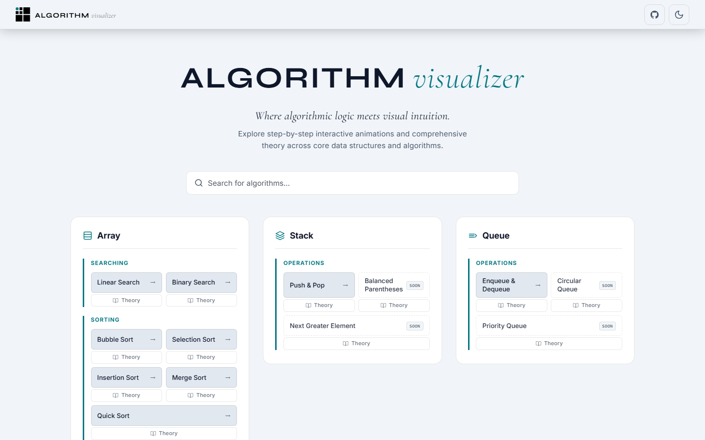
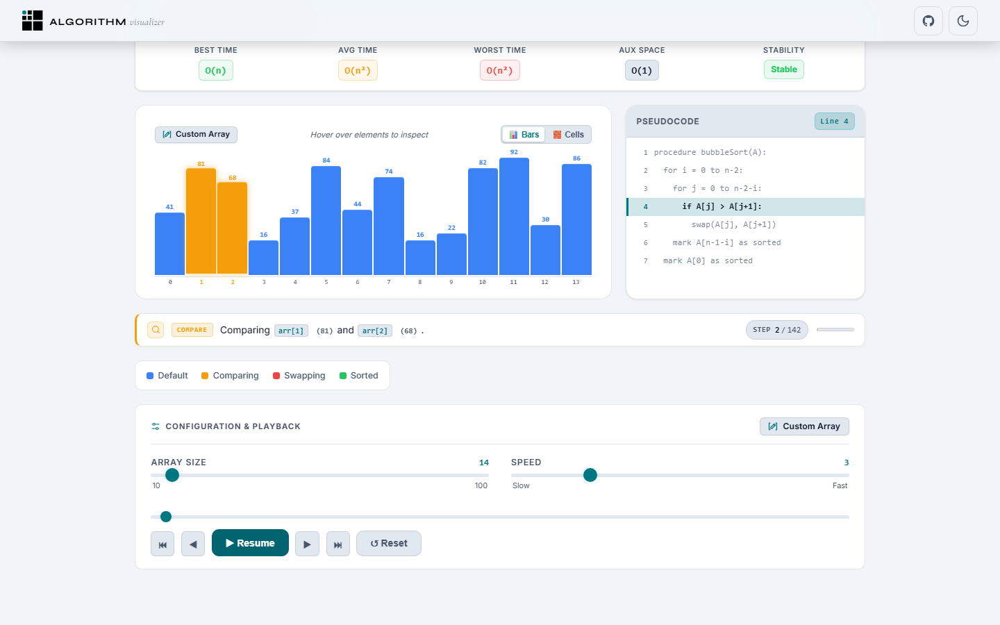
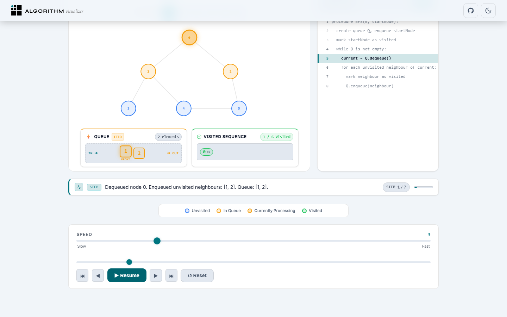
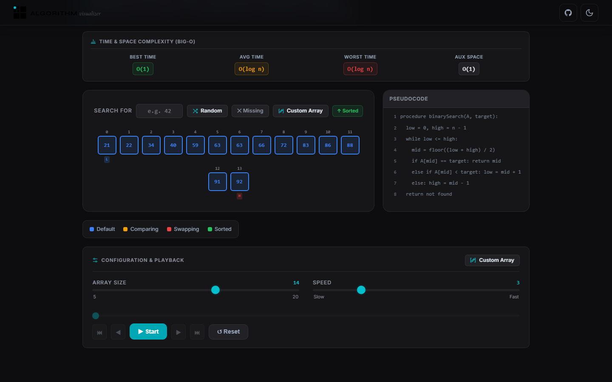

# Algorithm Visualizer

> Interactive algorithm and data-structure visualization with step-by-step execution, playback controls, synchronized pseudocode, and theory guides.

**[Live Demo](https://algorithm-visualizer-web.vercel.app)** · **[Report Bug](https://github.com/vinayakkumarr/algorithm-visualizer/issues)**

---

## Overview

**Algorithm Visualizer** is a client-side web application designed to help developers and computer science students understand algorithms and data structures through visual, step-by-step execution. 

Instead of reading static code or tracing execution manually on paper, users can watch algorithms execute in real time, scrub backward and forward through execution history, inspect variable states and memory cells, follow synchronized line-by-line pseudocode, and study comprehensive theoretical concepts.

---

## Screenshots

### Algorithm Catalog


### Bubble Sort Visualizer


### BFS Graph Visualizer


### Dark Mode


---

## Key Features

### Interactive Visualization & Playback
- **Step-by-Step Execution**: Play, pause, resume, step forward, and step backward through every operation.
- **Timeline Scrubbing**: Jump directly to any execution state using an interactive step scrubber.
- **Adjustable Speed**: Control execution speed dynamically from slow inspection to rapid playback (1× to 10×).
- **Live State Indication**: Visual color cues denote element states (default, comparing, swapping/writing, pivot, and sorted).
- **Step Narrator**: Explains the operation being performed at the current step.

### Configurable Input & Presets
- **Custom Input Support**: Create or paste custom numerical arrays with instant input validation.
- **Built-in Presets**: Quickly load representative scenarios (e.g., Random, Nearly Sorted, Reversed, Few Unique).
- **Dynamic Sizing**: Adjust dataset sizes dynamically using the size control slider.

### Visualization Modes
- **Dual View Modes (Array Visualizers)**: Switch between vertical **Bar View** (height proportional to value) and **Cell View** (fixed memory boxes showing numeric values and indexes).
- **Hover Inspection**: Hover over any bar or node to inspect its index, value, and current operational state.
- **Partition & Subarray Indicators**: Visual bounded overlays highlight active recursive partitions (e.g., in Quick Sort and Merge Sort).

### Learning & Reference
- **Synchronized Pseudocode Tracer**: Terminal-style pseudocode viewer with live line-level highlighting synchronized with the active step.
- **Theory & Reference Guides**: In-depth explanations covering conceptual analogies, mental models, algorithmic procedures, worked examples, and practical real-world applications.
- **Complexity Breakdown**: Big-O complexity tables detailing Best Case, Average Case, Worst Case, Auxiliary Space, and Algorithm Stability.

### UI & Accessibility
- **Archival Precision Grid**: Hardware VSync-synchronized 36px drafting grid with kinetic cell illuminations and diamond vertex reticles (active on Home catalog with 0% idle CPU hibernation).
- **Light & Dark Theme**: Full theme support with seamless toggling and `localStorage` persistence.
- **Responsive Layout**: Designed for mobile (375px+), tablet, and desktop viewports with sticky bottom controls on short displays.
- **Keyboard Navigation & ARIA**: "Skip to main content" link, focus containment and Escape-key dismiss on modals, keyboard-accessible playback controls, and ARIA live regions for dynamic step announcements.

---

## Supported Algorithms & Data Structures

The application catalogs 28 algorithm and data-structure topics, organized into **Interactive Visualizers** and **Comprehensive Theory Modules**.

### Interactive Visualizers (19 Topics)

| Category | Algorithm / Topic | Time Complexity (Worst) | Auxiliary Space | Status |
| :--- | :--- | :--- | :--- | :--- |
| **Searching** | Linear Search | $O(n)$ | $O(1)$ | Available |
| **Searching** | Binary Search | $O(\log n)$ | $O(1)$ | Available |
| **Sorting** | Bubble Sort | $O(n^2)$ | $O(1)$ | Available |
| **Sorting** | Selection Sort | $O(n^2)$ | $O(1)$ | Available |
| **Sorting** | Insertion Sort | $O(n^2)$ | $O(1)$ | Available |
| **Sorting** | Merge Sort | $O(n \log n)$ | $O(n)$ | Available |
| **Sorting** | Quick Sort | $O(n^2)$ | $O(\log n)$ | Available |
| **Stack** | Push & Pop | $O(1)$ | $O(1)$ | Available |
| **Queue** | Enqueue & Dequeue | $O(1)$ | $O(1)$ | Available |
| **Linked List** | Traversal | $O(n)$ | $O(1)$ | Available |
| **Linked List** | Singly Linked List (Insert / Delete) | $O(n)$ | $O(1)$ | Available |
| **Linked List** | Reverse Linked List | $O(n)$ | $O(1)$ | Available |
| **Linked List** | Detect Cycle (Floyd's Algorithm) | $O(n)$ | $O(1)$ | Available |
| **Tree** | BST Operations (Insert, Delete, Search) | $O(n)$ | $O(h)$ | Available |
| **Tree** | Inorder Traversal (LNR) | $O(n)$ | $O(h)$ | Available |
| **Tree** | Preorder Traversal (NLR) | $O(n)$ | $O(h)$ | Available |
| **Tree** | Postorder Traversal (LRN) | $O(n)$ | $O(h)$ | Available |
| **Graph** | Breadth-First Search (BFS) | $O(V + E)$ | $O(V)$ | Available |
| **Graph** | Depth-First Search (DFS) | $O(V + E)$ | $O(V)$ | Available |

### Theory & Reference Topics (9 Topics)

These topics currently provide theory & reference guides, worked examples, pseudocode, and complexity analysis, and are reserved for future interactive visualizer development:

- **Stack**: Balanced Parentheses, Next Greater Element
- **Queue**: Circular Queue (Ring Buffer), Priority Queue (Binary Heap)
- **Linked List**: Doubly Linked List (Insert & Delete)
- **Trees & Heaps**: Min Heap, Max Heap
- **Graphs**: Dijkstra's Algorithm, Bellman-Ford Algorithm

---

## Technical Architecture

The codebase follows a modular React architecture that separates algorithm logic from UI rendering:

```
┌─────────────────────────────────────────────────────────────┐
│                      React Application                      │
│                                                             │
│   ┌─────────────────────┐       ┌───────────────────────┐   │
│   │ VisualizerLayout UI │ <───> │ Playback & State      │   │
│   │  (Controls, Stage,  │       │ Context Engine        │   │
│   │  Pseudocode, Stats) │       │ (Step Index, Playing) │   │
│   └──────────┬──────────┘       └───────────┬───────────┘   │
│              │                              │               │
└──────────────┼──────────────────────────────┼───────────────┘
               ▼                              ▼
┌─────────────────────────────┐   ┌───────────────────────────┐
│      Theory Metadata        │   │   Algorithm Generators    │
│   (Lightweight Manifest)    │   │  (Step Execution Data)    │
│              │              │   │                           │
│              ▼ (On Demand)  │   │  - bubbleSort.js          │
│     Full Theory Content     │   │  - binarySearch.js        │
│     (Reference Content)     │   │  - bstAlgorithms.js       │
└─────────────────────────────┘   └───────────────────────────┘
```

### Architectural Highlights
1. **Algorithm Step Generators**: Algorithm modules in `src/algorithms/` generate step-by-step execution data consumed by the visualizers.
2. **Route-Level Code Splitting**: Algorithm visualizer pages and theory routes are loaded dynamically using `React.lazy()` and `Suspense`, optimizing initial resource loading.
3. **Deferred Theory Data**: A lightweight `theoryManifest.js` discovery file allows visualizer shells to determine theory availability immediately, deferring the download of the comprehensive `theoryData.js` dataset until the Theory tab or deep link is accessed.
4. **CSS Token System**: Built using native CSS Custom Properties with zero runtime CSS-in-JS overhead, supporting theme switching and responsive breakpoints.

---

## Tech Stack

| Technology | Purpose |
| :--- | :--- |
| **React** | Core UI library |
| **React DOM** | DOM rendering engine |
| **React Router DOM** | Client-side routing & deep linking |
| **Vite** | Development server and production bundler |
| **Vitest** | Unit and component test runner |
| **React Testing Library** | Component interaction testing |
| **Playwright** | End-to-end browser test automation |
| **Oxlint** | High-performance JavaScript/React linter |
| **@vercel/analytics** | Privacy-friendly web traffic and analytics telemetry |
| **Fontsource** | Self-hosted typography (Inter, Syne, Cormorant Garamond, Instrument Serif) |

---

## Project Structure

```text
algorithm-visualizer/
├── e2e/                           # Playwright end-to-end test suites
│   ├── accessibility.spec.js
│   ├── home.spec.js
│   ├── navigation.spec.js
│   ├── recovery-flows.spec.js
│   ├── release-gates.spec.js
│   ├── responsive.spec.js
│   ├── theory-pseudocode.spec.js
│   ├── visualizers-algorithms.spec.js
│   └── visualizers-playback.spec.js
├── public/                        # Static assets and favicon
├── src/
│   ├── algorithms/                # Algorithm step generators & presets
│   │   ├── binarySearch.js
│   │   ├── bubbleSort.js
│   │   ├── quickSort.js
│   │   ├── linkedListEngine.js
│   │   └── ...
│   ├── components/                # Shared UI, stages, controls, and modals
│   │   ├── AnimatedLogo.jsx
│   │   ├── ArrayBars.jsx
│   │   ├── CustomArrayModal.jsx
│   │   ├── Navbar.jsx
│   │   ├── PrecisionGrid.jsx
│   │   ├── PseudocodeViewer.jsx
│   │   ├── ThemeToggle.jsx
│   │   ├── TheorySection.jsx
│   │   ├── VisualizerLayout.jsx
│   │   └── ...
│   ├── context/                   # React Context providers (ThemeContext, VisualizerContext)
│   ├── data/                      # Theory content and metadata manifest
│   │   ├── theoryData.js          # Full theory and reference content
│   │   └── theoryManifest.js      # Lightweight discovery registry
│   ├── pages/                     # Routed pages and algorithm visualizers
│   │   ├── Home.jsx               # Algorithm catalog landing page
│   │   ├── NotFound.jsx           # 404 Recovery page
│   │   ├── TheoryTopicPage.jsx    # Standalone theory reference page
│   │   └── algorithms/            # Visualizer page implementations
│   │       ├── graph/
│   │       ├── linkedList/
│   │       ├── queue/
│   │       ├── searching/
│   │       ├── sorting/
│   │       ├── stack/
│   │       └── tree/
│   ├── App.css                    # Theme tokens, global reset, base styles, and accessibility utilities
│   ├── App.jsx                    # Routing configuration and lazy boundaries
│   └── main.jsx                   # Application entry point
├── tests/                         # Vitest unit and integration tests
│   ├── algorithms/                # Algorithm logic unit tests
│   ├── components/                # React component tests
│   ├── release/                   # Release gating tests
│   ├── theory/                    # Theory registry & pseudocode tests
│   └── setup.js                   # Test environment setup (jsdom)
├── LICENSE                        # MIT License
├── package.json                   # Project metadata and dependencies
├── playwright.config.js           # Playwright test configuration
├── vercel.json                    # Vercel SPA routing and deployment configuration
├── vite.config.js                 # Vite build configuration
└── vitest.config.js               # Vitest test configuration
```

---

## Getting Started

### Prerequisites
- **Node.js** (`^20.19.0` or `>=22.12.0` recommended, as required by Vite 8)
- **npm** (bundled with Node.js)

### Installation & Running Locally

1. Navigate to the project directory:
   ```bash
   cd algorithm-visualizer
   ```

2. Install project dependencies:
   ```bash
   npm install
   ```

3. Start the local development server:
   ```bash
   npm run dev
   ```

4. Open the local development URL (default: `http://localhost:5173`) in your browser.

---

## Available Scripts

The following npm scripts are configured in `package.json`:

| Command | Description |
| :--- | :--- |
| `npm run dev` | Starts the local Vite development server with Hot Module Replacement (HMR). |
| `npm run build` | Bundles the application for production in the `dist/` directory. |
| `npm run preview` | Locally serves the production build from `dist/` for verification. |
| `npm test` | Runs all unit and component tests once using Vitest. |
| `npm run test:watch` | Starts the Vitest interactive watch mode. |
| `npm run test:e2e` | Executes the Playwright end-to-end browser test suite. |
| `npm run lint` | Runs Oxlint to check code quality and detect lint errors. |

---

## Verification & Testing Status

The application is verified using automated test suites and static analysis:

- **Unit & Component Tests**: 206 tests passing across 13 test suites via Vitest.
- **End-to-End Tests**: 49 tests passing across 9 browser test suites via Playwright.
- **Static Analysis**: 0 lint errors via Oxlint.
- **Responsive Layouts**: Verified at 375px, 390px, 414px, 768px, 1024px, 1280px, and 1440px in both Dark and Light modes.
- **Production Build**: Verified production bundling with route-level code splitting and deferred chunk loading.

---

## Potential Future Work

Potential areas for future exploration and enhancement:
- Interactive visualizer canvases for remaining theory topics (Heaps, Dijkstra's, Bellman-Ford, Circular Queue).
- Graph visualizer support for user-defined graph nodes and edges.
- Additional algorithm categories and problem-solving patterns.
- Enhanced playback replay controls and timeline annotations.

---

## License

This project is licensed under the [MIT License](LICENSE).
